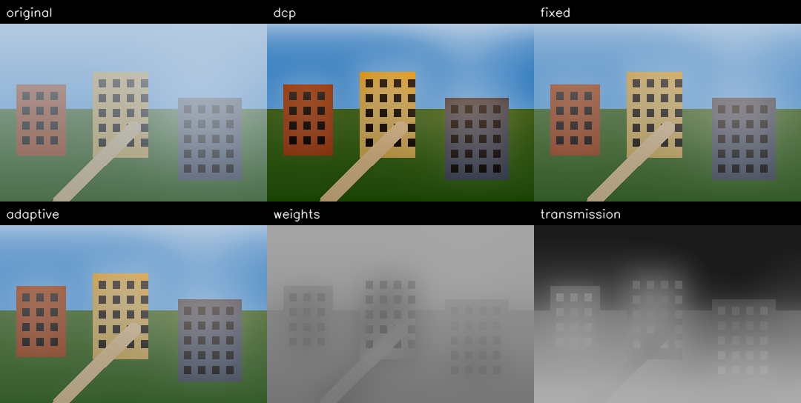

# CS5330: Spatially Adaptive Image Dehazing

Initial implementation for the final-project proposal: a Dark Channel Prior
(DCP) baseline plus local-feature blending of the original and dehazed image.

**Status:** runnable prototype. The feature coefficients are initial heuristics,
not trained or validated. No real-image benchmark or improvement claim yet.

## Quick start (including VS Code)

Open this folder in VS Code with **File → Open Folder**, then open its terminal.
Python 3.10+ is recommended. No GPU is required.
The prototype was checked on macOS with Python 3.13, NumPy 2.5.4, and OpenCV
4.14.0.94. `requirements-lock.txt` records that exact dependency pair;
`requirements.txt` allows compatible versions.

```bash
python3 -m venv .venv
source .venv/bin/activate
python -m pip install -r requirements.txt
python demo.py
python -m unittest -v
```

On Windows, activate with `.venv\Scripts\activate` instead.
In VS Code, use **Python: Select Interpreter** to select `.venv`.

Process an image you have permission to use:

```bash
python dehaze.py data/hazy.jpg --output results/example
```

Each run saves `original.png`, `dcp.png`, `fixed.png`, `adaptive.png`,
`weights.png`, `raw_weights.png`, `transmission.png`, the four feature maps,
`comparison.png`, and `run.json` with parameters. Images are processed at their
original resolution; large images can take more memory.

## Pipeline

1. Compute the dark channel using a local minimum over RGB channels and a 15×15 window.
2. Select atmospheric light from the brightest RGB pixel among the top 0.1% dark-channel pixels.
3. Estimate transmission with omega=0.95, refine with a grayscale guided filter,
   and recover the DCP image with transmission floored at 0.1.
4. Extract mean HSV value, mean saturation, luminance standard deviation, and
   mean Sobel gradient magnitude in densely overlapping windows.
5. Normalize contrast and gradient using fixed scales, then compute:

   `score = -0.5 + 1.5 * brightness - saturation - contrast - 0.5 * gradient`

   `weight_raw = sigmoid(score)`

6. Refine weights with the original grayscale image as guidance; clip to [0,1].
7. Blend: `adaptive = (1 - weight) * original + weight * dcp`.

The fixed baseline uses alpha=0.5 by default. Larger weights mean stronger use
of the DCP output. All calculations use float32 RGB in [0,1]. Guided filtering
uses radius=20 and epsilon=0.001 by default. This is a grayscale-guidance
implementation, not the full color guided filter.

## Example



The image is generated procedurally by `demo.py`. The panels show original
synthetic haze, DCP, fixed blending, adaptive blending, weights, and estimated
transmission. Grayscale weights and transmission maps use black=0, white=1.
This checks that the pipeline runs; it is not a natural-image dataset result.

## Current progress

- Implemented the DCP baseline, grayscale guided filtering, four local features,
  sigmoid weights, fixed blending, and adaptive blending.
- Generated the synthetic example and checked the image-file CLI end to end.
- Passed four test methods covering constant/black/tiny inputs, blending bounds
  and endpoints, constant guided-filter inputs, and invalid inputs.
- Real-image evaluation, coefficient tuning, and quantitative comparisons remain pending.

## Next experiments

- Confirm the group's dataset choice and create scene-disjoint validation/test splits.
- Tune patch size and feature coefficients on validation scenes only.
- Compare DCP, validation-tuned fixed blending, and adaptive blending on held-out scenes.
- Report PSNR/SSIM on correctly aligned paired hazy/clear images.
- Ablate feature terms and weight refinement; inspect sky, white surfaces,
  low-texture objects, color shifts, residual haze, and halos.

Brightness and low texture can reflect scene content rather than haze. The
weight map is a heuristic blending preference, not a calibrated haze estimate.
Blending can soften a bad DCP result but cannot recover details absent from both
inputs. Color/gamma handling and real-image behavior still need evaluation.

## References

- He, Sun, Tang. *Single Image Haze Removal Using Dark Channel Prior*, CVPR 2009.
  [Author project page](https://people.csail.mit.edu/kaiming/cvpr09/)
- He, Sun, Tang. *Guided Image Filtering*, ECCV 2010.
  [Author paper](https://kaiminghe.github.io/publications/eccv10guidedfilter.pdf)

The Python implementation in this repository was written for this prototype
with AI assistance. The algorithms above are attributed to their original authors.
