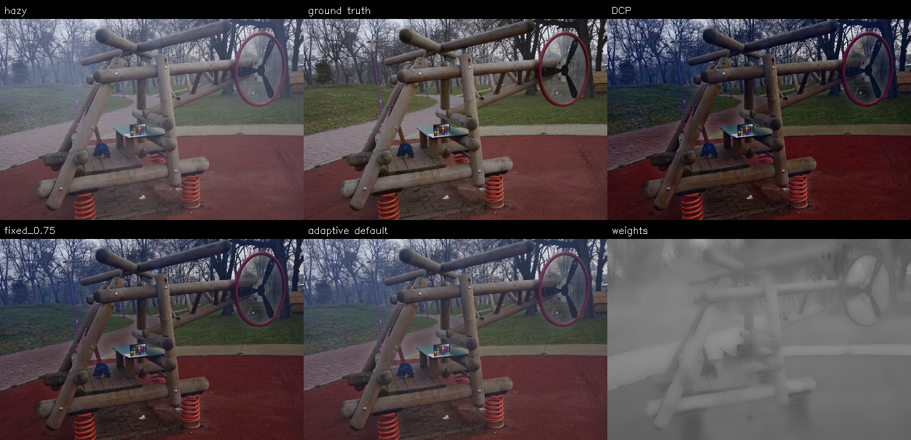
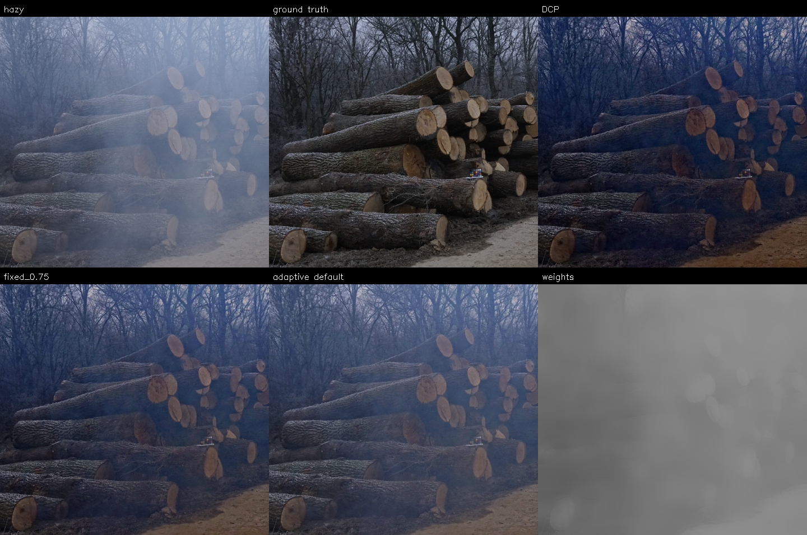

# Adaptive blending: validation study

## Scope and reproducibility

This study covers fixed blending, local-feature ablations, weight-refinement
ablation, a small feature-window/bias search, and qualitative failure analysis.
It uses the committed 79-pair validation split (43 NH-HAZE, 36 O-HAZE), at the
repository's quarter-size resolution. The 20-pair test split was not evaluated.
All variants share DCP patch=15, omega=.95, t_min=.1, radius=20, eps=.001.
PSNR and RGB SSIM use range [0,1]. Results are means over images, weighted by
image count across datasets, not an equal-dataset average.

Reproduce from the repository root (choose an unused output directory):

```bash
python -m pip install -r requirements-eval.txt
python run_validation_study.py --output evaluation_results/validation_study
```

`config.json` records the predeclared grid/objective and script hashes;
`image_metrics.csv` contains every image/method measurement. Exact ties select
the first listed candidate. The search objective was overall validation PSNR.

## Fixed blending and parameter search

| Method | Mean PSNR (dB) | Mean SSIM |
|---|---:|---:|
| Original | 12.6244 | .5173 |
| DCP | 14.2861 | .5890 |
| Fixed alpha=.25 | 14.1350 | .5640 |
| Fixed alpha=.50 | 15.1702 | .5974 |
| Fixed alpha=.75 | 15.2206 | .6105 |
| Default adaptive | 15.2395 | .5962 |
| Matched-mean fixed | 15.2064 | .5995 |
| Selected adaptive: feature patch=31, bias=0 | 15.3457 | .6058 |

Alpha=0 and alpha=1 are the original and DCP endpoints. The selected global
alpha is .75. The adaptive search used feature patch sizes {7,15,31} and biases
{-1,-.5,0}; DCP patch size was held fixed. The selected adaptive model improves
validation PSNR over selected fixed by .1251 dB but has lower SSIM (.6058 vs
.6105). This is a validation selection result, not a held-out improvement claim.
Patch=15/bias=0 scores 15.3456 dB, nearly identical to patch=31/bias=0;
there is little evidence here for preferring the larger feature window.

## Ablations of the default model

Each feature ablation sets only that feature's coefficient to zero. The
no-refinement variant uses the sigmoid weight before guided filtering.

| Variant | Mean PSNR (dB) | Mean SSIM |
|---|---:|---:|
| Default adaptive | 15.2395 | .5962 |
| No brightness | 14.3940 | .5713 |
| No saturation | 15.4024 | .6022 |
| No contrast | 15.2707 | .5987 |
| No gradient | 15.2464 | .5968 |
| No weight refinement | 15.2343 | .5985 |

Removing brightness reduces both metrics substantially. Removing saturation
improves both metrics on this validation split, suggesting its current negative
coefficient deserves reconsideration. Contrast and gradient removals change
PSNR only slightly. Refinement slightly raises PSNR while lowering SSIM; these
numbers do not support claiming it improves both metrics. These are effects of
specific heuristic settings, not proof that any feature is intrinsically useful
or useless. Ablation variants were diagnostic and excluded from the predeclared
patch/bias model-selection grid; no-saturation merits a future controlled study.

## Qualitative comparison

Panels: hazy, ground truth, DCP, validation-selected fixed alpha=.75, default
adaptive, default adaptive weights. Weights use black=0 and white=1. Examples
are deliberately the largest PSNR win and loss of default adaptive versus the
selected fixed baseline; they are not representative random samples or displays
of the tuned adaptive model. All panels share the same intensity scale.



O-HAZE 022: default adaptive exceeds selected fixed by 3.5207 dB. DCP visibly
darkens the playground and produces stronger colors. Adaptive blending retains
more of the original brightness and is closer in PSNR to the clear reference.
Residual haze is still visible, especially in the background.



O-HAZE 006: default adaptive trails selected fixed by 3.0252 dB. The log scene
retains a visible hazy veil under adaptive blending. Stronger fixed blending
removes more of that veil, although a blue cast remains in the restored images
relative to the clear reference. This illustrates why softer dehazing can help
one scene and under-correct another.

## Conclusion and handoff

A tuned global blend is a necessary baseline. Current validation gains from
spatial adaptation are small and metric-dependent. The strongest practical
finding is that the initial saturation term hurts this split. Before any final
claim, agree with the teammate on prior dataset usage, freeze configurations,
and evaluate untouched scenes. Dataset licensing/provenance, course-specific
rubric compliance, final test results, and final slides/report remain joint work.
This document describes completed experiment work; it does not establish the
team's agreed individual contribution allocation.
